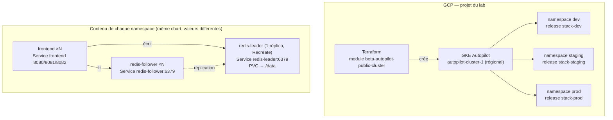

# « Livre d'or Cloud » — Guestbook sur GKE Autopilot

**Terraform + Helm + Kubernetes · équipe de 3**

Livre d'or numérique pour les hôtels du groupe Cloud Hôtels : un frontend PHP et une base Redis
leader/follower, déployés sur un cluster GKE Autopilot créé en code, packagés dans un chart Helm
unique et installés dans trois environnements isolés (`dev`, `staging`, `prod`), avec le même
chart en local sur minikube.

Ce README est le point d'entrée : il permet de recréer le cluster, de redéployer l'application et
d'exploiter la plateforme sans aide extérieure.

---

## 1. Présentation

### Le problème

Le prototype Guestbook installé à la main sur un poste perdait tous les messages à chaque
redémarrage. Le projet doit rendre l'application :

- **reconstructible** : le cluster est créé par Terraform, pas à la console ;
- **persistante** : un redémarrage de pod, une mise à jour ou un remplacement de nœud ne doit
  perdre aucun message ;
- **reproductible** : un seul chart Helm, trois environnements, seules les valeurs changent ;
- **portable** : le même chart tourne en local (minikube) et sur GKE.

### Ce qui est automatisé

| Domaine | Outil | Ce qui est produit |
|---|---|---|
| Infrastructure | Terraform | cluster GKE Autopilot régional, compte de service des nœuds, rôles IAM |
| Application | Helm | 9 objets Kubernetes par environnement (3 deployments, 3 services, 2 ConfigMaps, 1 PVC) |
| Configuration | ConfigMaps + `values-<ENV>.yaml` | aucune valeur d'environnement figée dans les manifestes |
| Persistance | PVC + AOF Redis | données Redis dans `/data`, volume provisionné par la StorageClass par défaut |

### Ce qui n'est pas automatisé

| Point | Raison |
|---|---|
| Création du projet GCP | Fourni par le lab Google Skills ; projet éphémère, supprimé en fin de session |
| Activation des APIs GCP | Faite par le lab (`container.googleapis.com`, `compute.googleapis.com`) |
| Installation des outils | Prérequis du poste de travail (§3) |
| DNS, nom de domaine, HTTPS | Hors périmètre ; le frontend est exposé en HTTP sur une IP publique |
| Sauvegarde et restauration du volume | Non traité ; voir §9 (dette technique) |
| Supervision applicative (métriques, alertes) | Seuls les métriques par défaut de GKE sont disponibles |

### Livrables

- le dépôt (ce README, `terraform/`, `k8s/`, `helm/`, `docs/`) ;
- la documentation de transfert : ce README, `docs/`, et `terraform/README.md` ;
- la soutenance : scénario de démonstration dans [`docs/soutenance.md`](docs/soutenance.md).

---

## 2. Architecture

### Vue d'ensemble



### Flux applicatif

1. Le client ouvre la page servie par le **frontend** (PHP + Apache).
2. Une écriture (`cmd=set`) part vers le **Service `redis-leader`** : c'est le seul Redis qui
   écrit dans `/data`.
3. Une lecture (`cmd=get`) part vers le **Service `redis-follower`**, dont les réplicas sont
   synchronisés sur le leader.
4. Le frontend trouve ces deux noms par DNS (variable `GET_HOSTS_FROM=dns`) : les Services
   Redis portent donc **obligatoirement** les noms `redis-leader` et `redis-follower`.

### Où sont les données

Dans le **PersistentVolumeClaim `redis-leader-pvc`**, monté sur `/data` du pod leader. Redis y
écrit un journal append-only (`appendonly yes`) : chaque écriture est rejouée au démarrage, donc
un pod supprimé puis recréé retrouve l'intégralité des messages. La StorageClass est celle du
cluster par défaut (`standard` sur minikube, `standard-rwo` sur GKE) : le champ `storageClassName`
est absent du manifeste généré, jamais écrit vide.

### Frontière Terraform / Helm

| | Terraform | Helm |
|---|---|---|
| Crée | le cluster, le compte de service, les rôles IAM | deployments, services, ConfigMaps, PVC |
| Ne crée pas | aucun objet Kubernetes applicatif | aucune ressource GCP |
| Cycle de vie | `apply` / `destroy`, plusieurs minutes | `install` / `upgrade` / `rollback`, quelques secondes |
| Conséquence | détruire le cluster détruit tout ce qu'il contient | `helm uninstall` supprime les objets de la release, y compris le PVC (donc les données) |

Le détail du cluster est dans [`terraform/README.md`](terraform/README.md) et
[`docs/architecture.md`](docs/architecture.md).

---

## 3. Prérequis et accès

### Outils

| Outil | Version utilisée | Vérification |
|---|---|---|
| Terraform | ≥ 1.3 (1.17 testée) | `terraform version` |
| gcloud | SDK récent | `gcloud version` |
| `gke-gcloud-auth-plugin` | plugin d'authentification GKE | `gke-gcloud-auth-plugin --version` |
| kubectl | 1.34+ (1.36 testé) | `kubectl version --client` |
| Helm | 3.x ou 4.x (4.3 testé) | `helm version` |
| minikube | 1.33+ | `minikube version` |
| Docker Desktop | démarré | `docker version` |

### Droits et comptes

- Un **projet GCP** avec un rôle permettant de créer un cluster GKE, des comptes de service et
  des bindings IAM (rôle `owner` ou équivalent dans le projet du lab).
- Les APIs `container.googleapis.com` et `compute.googleapis.com` activées.
- Un **réseau VPC `default`** avec sous-réseau dans la région choisie.

### Contraintes de l'environnement de lab

- Le projet est **temporaire** : tout est supprimé à la fin de la session.
- L'ID de projet et la région **changent à chaque session** : ils ne sont jamais écrits dans le
  code, uniquement dans `terraform.tfvars` (non versionné).
- La création d'un cluster Autopilot prend **10 à 15 minutes**, la destruction 5 à 10 minutes :
  lancer `terraform apply` en début de session, et désinstaller les releases Helm avant
  `terraform destroy`.
- Un seul opérateur Terraform à la fois (state local, pas de verrou).

---

## 4. Déploiement de zéro

### 4.1 Local — minikube

```bash
# 1) Cluster local
minikube start --driver=docker --cpus=4 --memory=8192
kubectl config use-context minikube
kubectl get nodes                    # attendu : un nœud Ready

# 2) Namespaces (le chart ne les crée pas)
kubectl apply -f k8s/namespaces.yaml
kubectl get ns                       # attendu : dev, staging, prod

# 3) Validation des manifestes bruts (namespace jetable, ne pas utiliser dev)
kubectl create namespace sandbox
kubectl apply -f k8s/ -n sandbox
kubectl get all,cm,pvc -n sandbox    # attendu : 3 deployments, 3 services, 2 cm, 1 pvc
kubectl port-forward svc/frontend 8080:8080 -n sandbox
# puis http://127.0.0.1:8080
kubectl delete namespace sandbox

# 4) Les trois environnements avec le chart
helm lint helm/guestbook -f helm/guestbook/values-dev.yaml
helm install stack-dev     helm/guestbook -n dev     -f helm/guestbook/values-dev.yaml
helm install stack-staging helm/guestbook -n staging -f helm/guestbook/values-staging.yaml
helm install stack-prod    helm/guestbook -n prod    -f helm/guestbook/values-prod.yaml
helm list -A                          # attendu : trois releases deployed

# 5) Accès : terminal administrateur séparé, à laisser tourner
minikube tunnel
kubectl get svc -A | grep frontend    # attendu : EXTERNAL-IP 127.0.0.1
```

URLs attendues : `http://127.0.0.1:8080` (dev), `:8081` (staging), `:8082` (prod).

### 4.2 Cloud — GKE

```bash
# 1) Valeurs de la session
cd terraform
cp terraform.tfvars.example terraform.tfvars
# renseigner project_id et region (panneau « Lab details » du lab)

# 2) Création du cluster (10 à 15 min)
terraform init
terraform fmt -check -recursive
terraform validate
terraform plan                        # attendu : 7 ressources à créer
terraform apply
terraform output                      # nom, région, endpoint, commande de connexion

# 3) Connexion de kubectl
gcloud container clusters get-credentials "$(terraform output -raw cluster_name)" \
  --location "$(terraform output -raw cluster_region)" \
  --project "$(terraform output -raw project_id)"
kubectl config current-context        # gke_<projet>_<région>_<cluster>
kubectl cluster-info
```

```bash
# 4) Namespaces et release dev en ClusterIP (phase de test, rien d'exposé sur Internet)
cd ..
kubectl apply -f k8s/namespaces.yaml
helm install stack-dev helm/guestbook -n dev -f helm/guestbook/values-dev.yaml \
  --set frontend.service.type=ClusterIP
kubectl wait --for=condition=Ready pod -l app.kubernetes.io/instance=stack-dev -n dev --timeout=420s

kubectl port-forward svc/frontend 8080:8080 -n dev
# dans un second terminal : ajouter des messages
curl -s "http://127.0.0.1:8080/guestbook.php?cmd=set&value=bonjour-dev,messages-test"
curl -s "http://127.0.0.1:8080/guestbook.php?cmd=get"
```

```bash
# 5) Ouverture : le Service passe en LoadBalancer
helm upgrade stack-dev helm/guestbook -n dev -f helm/guestbook/values-dev.yaml
kubectl get svc frontend -n dev -w    # attendre l'EXTERNAL-IP (2 à 5 min)

# 6) staging et prod
helm install stack-staging helm/guestbook -n staging -f helm/guestbook/values-staging.yaml
helm install stack-prod    helm/guestbook -n prod    -f helm/guestbook/values-prod.yaml
helm list -A
kubectl get pods -n dev
kubectl get pods -n staging
kubectl get pods -n prod
```

Résultats attendus :

- `helm list -A` : trois releases `deployed` dans leurs namespaces ;
- `kubectl get svc frontend -n dev` : `EXTERNAL-IP` renseignée, port 8080 ;
- l'application répond sur `http://<IP>:8080` (dev), `:8081` (staging), `:8082` (prod) ;
- un message saisi dans `dev` n'apparaît pas dans `prod` (namespaces isolés).

### 4.3 Vérifier l'idempotence

```bash
cd terraform && terraform plan        # attendu : « No changes. Your infrastructure matches… »
helm upgrade stack-prod helm/guestbook -n prod -f helm/guestbook/values-prod.yaml
kubectl get pods -n prod              # attendu : mêmes pods, aucun redémarrage
```

---

## 5. Runbooks d'exploitation

Chaque opération a sa fiche, avec commandes et vérification :

| # | Runbook | Fichier |
|---|---|---|
| 1 | Déployer une nouvelle version de l'application | [`docs/runbooks/01-nouvelle-version.md`](docs/runbooks/01-nouvelle-version.md) |
| 2 | Revenir à la révision précédente | [`docs/runbooks/02-rollback.md`](docs/runbooks/02-rollback.md) |
| 3 | Modifier la configuration d'un environnement | [`docs/runbooks/03-modifier-configuration.md`](docs/runbooks/03-modifier-configuration.md) |
| 4 | Augmenter les réplicas ou les ressources | [`docs/runbooks/04-replicas-ressources.md`](docs/runbooks/04-replicas-ressources.md) |
| 5 | Agrandir le volume persistant | [`docs/runbooks/05-agrandir-volume.md`](docs/runbooks/05-agrandir-volume.md) |
| 6 | Vérifier que les données sont persistées | [`docs/runbooks/06-verifier-persistance.md`](docs/runbooks/06-verifier-persistance.md) |
| 7 | Basculer entre `ClusterIP` et `LoadBalancer` | [`docs/runbooks/07-basculer-service.md`](docs/runbooks/07-basculer-service.md) |
| 8 | Se reconnecter au cluster depuis un nouveau poste | [`docs/runbooks/08-reconnexion.md`](docs/runbooks/08-reconnexion.md) |
| 9 | Désinstaller les releases puis détruire le cluster | [`docs/runbooks/09-desinstaller-detruire.md`](docs/runbooks/09-desinstaller-detruire.md) |

Règle générale : **installation et évolutions uniquement avec Helm**. Les seules commandes
`kubectl` admises sur un environnement partagé sont la lecture (get/describe/logs), le
`port-forward`, et le `rollout restart` explicitement prévu au runbook 3.

---

## 6. Référence

### 6.1 Terraform

Détail complet (ressources créées, variables, providers, outputs, state) dans
[`terraform/README.md`](terraform/README.md). Résumé :

- module `terraform-google-modules/kubernetes-engine/google//modules/beta-autopilot-public-cluster`, version `~> 46.0` ;
- 7 ressources (cluster Autopilot, compte de service des nœuds + 3 bindings IAM, 2 ressources aléatoires) ;
- 9 variables, dont `project_id` et `region` sans valeur par défaut ;
- 7 outputs, dont `connection_command` et `cluster_endpoint` (sensible).

### 6.2 Objets Kubernetes créés par le chart

Chaque release crée les 9 objets suivants (noms fixes, identiques dans les trois namespaces) :

| Type | Nom | Rôle |
|---|---|---|
| Deployment | `frontend` | frontend PHP, réplicas selon l'environnement |
| Deployment | `redis-leader` | Redis principal, 1 réplica, stratégie `Recreate` |
| Deployment | `redis-follower` | réplicas Redis en lecture, synchronisés sur le leader |
| Service | `frontend` | `LoadBalancer` (port 8080/8081/8082) ou `ClusterIP` |
| Service | `redis-leader` | `ClusterIP:6379`, non exposé |
| Service | `redis-follower` | `ClusterIP:6379`, non exposé |
| ConfigMap | `frontend-config` | `GET_HOSTS_FROM=dns` |
| ConfigMap | `redis-leader-config` | `redis.conf` (dir, appendonly, bind, mode protégé) |
| PVC | `redis-leader-pvc` | volume des données, monté sur `/data` |

Les probes et les ressources sont définis dans les templates (pas dans les valeurs) ; leurs
paramètres et leur justification sont dans [`docs/valeurs-helm.md`](docs/valeurs-helm.md), et la
stratégie du leader dans [`docs/decisions/002-recreate-leader.md`](docs/decisions/002-recreate-leader.md).

### 6.3 Valeurs Helm

Tableau complet dans [`docs/valeurs-helm.md`](docs/valeurs-helm.md). Les valeurs qui changent
entre environnements :

| Paramètre | dev | staging | prod |
|---|---|---|---|
| `frontend.replicaCount` | 2 | 2 | 3 |
| `redisFollower.replicaCount` | 1 | 2 | 2 |
| `frontend.service.port` | 8080 | 8081 | 8082 |
| `frontend.resources.requests` | 100m / 128Mi | 200m / 256Mi | 250m / 256Mi |
| `frontend.resources.limits` | 250m / 256Mi | 500m / 512Mi | 500m / 512Mi |
| `redisLeader.persistence.size` | 1Gi | 2Gi | 5Gi |
| `commonLabels.environment` | dev | staging | prod |

Le type du Service frontend est `LoadBalancer` par défaut ; sur GKE, la phase de test le passe en
`ClusterIP` avec `--set frontend.service.type=ClusterIP`.

---

## 7. Décisions techniques

Chaque décision a sa fiche, avec le contexte, le choix et les alternatives écartées.

| Décision | Fiche |
|---|---|
| Noms de Services Redis figés (`redis-leader`, `redis-follower`) | [`docs/decisions/001-noms-services.md`](docs/decisions/001-noms-services.md) |
| Stratégie `Recreate` sur le leader, `RollingUpdate` ailleurs | [`docs/decisions/002-recreate-leader.md`](docs/decisions/002-recreate-leader.md) |
| Persistance Redis (AOF, PVC, `storageClassName` vide) | [`docs/decisions/003-persistance.md`](docs/decisions/003-persistance.md) |
| Un seul chart, trois environnements, surcharge local/cloud | [`docs/decisions/004-un-chart-plusieurs-envs.md`](docs/decisions/004-un-chart-plusieurs-envs.md) |
| State Terraform local | [`docs/decisions/005-state-local.md`](docs/decisions/005-state-local.md) |
| Relation entre `k8s/` (manifestes bruts) et `helm/` (chart) | [`docs/decisions/006-k8s-et-helm.md`](docs/decisions/006-k8s-et-helm.md) |

---

## 8. Diagnostic — où regarder en cas de problème

Guide complet : [`docs/troubleshooting.md`](docs/troubleshooting.md). Les réflexes de base :

```bash
kubectl config current-context          # minikube ou GKE ?
kubectl get pods -n <env> -o wide
kubectl describe pod <pod> -n <env>
kubectl logs deploy/frontend -n <env>
kubectl get events -n <env> --sort-by=.lastTimestamp
kubectl get svc,endpoints -n <env>      # Endpoints vides = sélecteur faux
kubectl get pvc -n <env>                # Pending = StorageClass
helm status stack-<env> -n <env>
helm get values stack-<env> -n <env>
```

---


## 10. Structure du dépôt

```
.
├── README.md                      <- ce document (point d'entrée)
├── docs/
│   ├── architecture.md            <- schéma détaillé, flux, frontière Terraform/Helm
│   ├── decisions/                 <- ADR : choix structurants et alternatives
│   ├── runbooks/                  <- les 9 opérations d'exploitation
│   ├── valeurs-helm.md            <- tableau complet des valeurs du chart
│   ├── troubleshooting.md         <- diagnostic et erreurs rencontrées
│   └── soutenance.md              <- scénario de démonstration
├── terraform/
│   ├── versions.tf                <- versions Terraform et providers
│   ├── variables.tf               <- 9 variables d'entrée
│   ├── main.tf                    <- appel du module GKE Autopilot
│   ├── outputs.tf                 <- 7 sorties d'exploitation
│   ├── terraform.tfvars.example   <- modèle (le vrai tfvars n'est pas versionné)
│   ├── .terraform.lock.hcl        <- versions exactes des providers (versionné)
│   └── README.md                  <- documentation Terraform complète
├── k8s/                           <- manifestes bruts, référence de l'étape 1
│   ├── namespaces.yaml
│   ├── frontend-*.yaml
│   ├── redis-leader-*.yaml
│   └── redis-follower-*.yaml
└── helm/
    └── guestbook/                 <- chart unique des trois environnements
        ├── Chart.yaml
        ├── values.yaml            <- valeurs par défaut
        ├── values-dev.yaml
        ├── values-staging.yaml
        ├── values-prod.yaml
        └── templates/             <- un template par objet
```

`k8s/` est la référence lisible des manifestes, validée sur minikube ; `helm/guestbook/` en est la
version paramétrée. Le chart est la seule source de vérité pour les environnements partagés.

---

## 11. Équipe

Projet réalisé à trois. Le travail a été découpé en trois domaines, chacun relu par les deux autres
membres avant merge :

| Domaine | Contenu |
|---|---|
| Cloud / Terraform | `terraform/`, sessions de lab, connexion au cluster, documentation Terraform |
| Kubernetes / persistance | `k8s/`, probes, ressources, `redis.conf`, PVC, tests de non-perte |
| Helm / environnements | `helm/guestbook/`, valeurs, releases minikube et GKE, documentation de transfert |

La documentation est l'affaire de tous : chaque partie est documentée par celui qui l'a produite,
dans la merge request correspondante. L'historique Git montre des commits de chaque membre sur
plusieurs dossiers, et la soutenance peut interroger n'importe qui sur n'importe quelle partie
(le scénario de démonstration prévoit d'ailleurs une répartition des étapes entre les membres).
